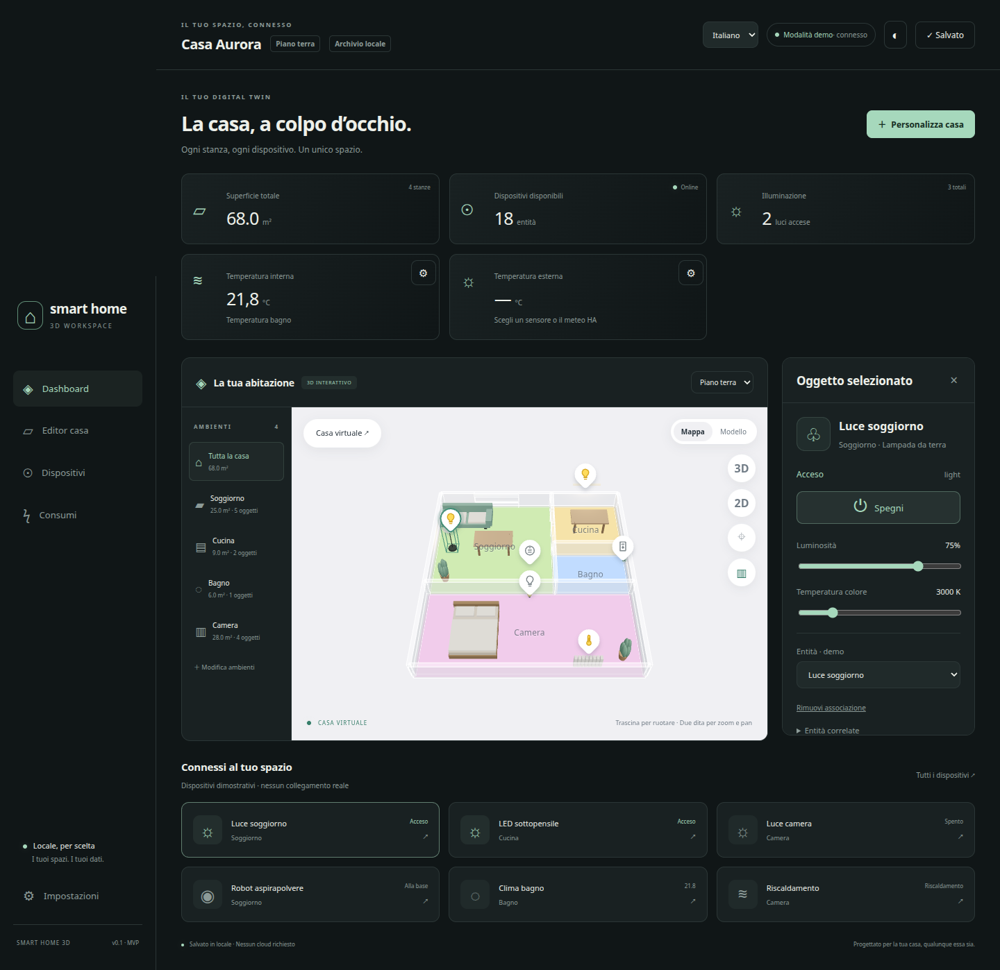

# Smart Home 3D

This is the **frontend** repository, with its own npm workspace. In the shared SmartHome3D directory, its source lives in `frontend/`, alongside the Java/Maven `backend/` repository. Each directory is independent, without exported or duplicated source trees. Run this guide's commands from `frontend/`.

**First installation:** follow the [guide to hosting the project on your machine](docs/INSTALLATION.md): download, prerequisites, HA in Docker, frontend/backend startup, first sign-in, smartphones, deployment, and backups.

Projects, original files, ZIP backups, and server sessions are available in **Storage and server**. The backend is optional and connects through a runtime URL. See [connecting the repositories](docs/BACKEND.md).

**Energy:** [tariffs, electricity profiles, gas estimates, and monthly dashboard](docs/ENERGY.md). Per-home settings work offline; HA collection and history use the server database and full ZIP backups. Sensor readings, estimates, and bill actuals are distinguished. After restarting the backend, sign in as the owner to resume collection.

**Temperature and language:** see the [dashboard guide](docs/DASHBOARD.md). The top-right selector switches between Italian and English; indoor/outdoor cards use configurable sensors and HA weather as an alternative to an outdoor thermometer. Sources are saved with the home. **Energy → Devices** lists only devices bound to the open home.

On first access, choose **Sign in to your server** in the wizard to retrieve an existing home. Casa Aurora is saved only when you choose the demo. Use server sign-in after a restart; local transfer and ZIP restoration are separate operations.

The server profile retains the last selected home and encrypted Home Assistant authorization. After restarting, signing in restores the home and connected devices. When upgrading from the earlier memory-only version, authorize HA once. **Sign out of the server** keeps the connection; **Unlink Home Assistant from your profile** removes it. Home JSON/ZIP backups contain no credentials.

A local, manufacturer-independent digital twin of your home. Angular, Three.js, and a parametric geometric model shared by the 2D editor and 3D scene. Home Assistant is the central provider; demo mode works without a server or real devices.

**Robot vacuums:** [one detail card for sensors, routines, and dock](docs/ROBOT_VACUUM.md), search across related entities, standard controls, and Roborock position readings when exposed by HA. After two-point alignment, received samples reposition the robot in the home. Optional updates run every 60 seconds while moving; testing with the physical model is still required.

**Features:** [Home Assistant PKCE sign-in](docs/HOME_ASSISTANT_AUTH.md), [room cleaning from robot details](docs/ROBOT_VACUUM.md), and [local floor-plan generation and virtual home](docs/FLOORPLAN_GENERATION.md). Import PNG/JPEG/PDF, calibrate the scale, review detected walls, and create an editable 3D floor. Map view adds pastel floors, low white walls, labels, and device pins, including full-screen mode. Detection includes slanted walls and proposed doors/windows requiring confirmation; names, furniture, and details need review.



## Requirements and startup

To test from a phone on the same network, use `npm run start:lan` and follow the [smartphone guide](docs/SMARTPHONE.md), including HTTPS and backend access through the same address.

- Node.js 24 LTS, npm, and a current browser with WebGL2. `.nvmrc` selects Node 24.
- Browser tests require installed Chrome or `CHROME_PATH` pointing to its executable.
- Docker Compose is needed only for deployment and Home Assistant.

```bash
npm ci
npm start
```

Open Angular's printed URL, normally **http://127.0.0.1:4200**. If the port is occupied, use `npm start -- --port 4300`. No system services are started. The app supports Italian/English, dark/light themes, and a top-right language selector; select **English** to follow the UI labels in this documentation.

## First use

1. Choose **Explore the demo** to open Casa Aurora with four rooms and simulated devices. Demo states do not represent your physical devices.
2. For your own home, choose **Create your home → Start offline**. In the editor, select **Wall** and click vertices, returning to the first point to close a room. Shared wall segments are reused.
3. **Select** lets you drag vertices and objects. Click a wall to edit its length, thickness, and height in meters. Add doors/windows by clicking a wall with the corresponding tool.
4. Add a light from the catalog. In **Link entity**, select a mock light. Toggle it from the panel, then open **View in 3D**. The light changes its emissive material and, in medium/high profiles, lights the scene.
5. The scene supports rotation, zoom, touch panning, raycast selection, room focus, and double-clicking the selected object. The bottom toolbar provides top/isometric views, framing, and wall visibility.
6. Autosave runs after 500 ms of inactivity. **Save project** saves immediately. Settings let you create, open, delete, and export projects.

The local database belongs to a browser and origin (protocol, host, and port). Use the same URL to find the same projects. Export a JSON backup before clearing browser data. Mock device states reset on reload; geometry, objects, and bindings persist.

## Floor plans and assets

PNG, JPEG, and PDF files up to 20 MB are processed **in the browser**, without uploading for analysis. Images are reduced to at most 4096 pixels per side; PDFs produce a preview of the **first page**. Calibrate using two points at a known distance in meters. The reference supports origin, rotation, scale, and opacity.

In local mode, the original is stored in IndexedDB and can be downloaded from the editor. Exported JSON embeds the raster preview, **not the original PDF or GLBs**. To transfer originals too, use the full ZIP backup or server transfer: [storage and backups](docs/BACKEND.md).

An object can use a self-contained local GLB 2.0 file, up to 15 MB, from **Local 3D model**. External resources and compression requiring extra decoders are rejected. The procedural catalog works without commercial assets.

## Home Assistant

For a new installation, follow [Home Assistant Container on Linux](docs/HOME_ASSISTANT_LOCAL.md): file preparation, Docker startup, onboarding, backups, and updates. For a persistent connection through the backend, use the [full installation guide](docs/INSTALLATION.md).

In local mode, enter the URL in **Settings** and choose **Sign in with Home Assistant**. OAuth with PKCE opens HA and renews the session while the tab remains open. Tokens and PKCE data stay **in memory only**, never in IndexedDB, logs, or exports. After reloading, sign in to the real provider again; saved homes and bindings remain. Manual token access is available in advanced options. See [sign-in and sessions](docs/HOME_ASSISTANT_AUTH.md).

The provider uses `/api/websocket`, authentication, `state_changed` subscriptions, an initial snapshot, acknowledged commands, heartbeat, and reconnection with backoff. Areas/Floors/Devices registries enrich suggestions when accessible. Mapping remains explicit and checks the object's domain. Related entities can link, for example, a battery sensor and a robot.

A direct connection from an HTTPS page requires `wss://` for HA. HTTP/WS over a LAN does not encrypt tokens; use it only on a trusted network. Installing a PWA on a LAN phone requires HTTPS with a trusted certificate. Public access requires a suitable secure access architecture. See [integrations and security](docs/DEVICE_INTEGRATIONS.md).

## Checks

```bash
npm test
npm run typecheck
npm run build:dev
npm run build
npm run test:e2e
# After the production build, test PWA and offline reopening:
SH3D_PRODUCTION=1 npm run test:e2e
docker compose -f infrastructure/docker/compose.yaml --profile web config --quiet
```

Unit tests use Vitest, `fake-indexeddb`, and a simulated HA WebSocket. End-to-end tests use headless Chrome on dedicated port **4307** (production/PWA: **4308**), starting and stopping their own test server. They do not access real devices. Implementation-session results are in [docs/VERIFICATION.md](docs/VERIFICATION.md).

Production output is in `dist/web/browser`. Angular registers the service worker only in production; the app shell and visited routes work offline after activation and caching. HA still requires a reachable server. PDF modules are cached on first use. Very old Android browsers without WebGL2 or modern JavaScript are not guaranteed to work; the low graphics profile reduces rendering cost but does not replace those APIs.

## Linux deployment

The [installation guide](docs/INSTALLATION.md#docker-deployment-after-the-first-test) covers backend Docker, a compiled frontend served by Nginx, volumes, and HTTPS access. For a new HA instance, first follow [Home Assistant Container setup](docs/HOME_ASSISTANT_LOCAL.md), which creates the required YAML files. If HA already exists, connect that instance.

Frontend, backend, and HA can share one machine. Rendering and PDFs run in the browser. Included Nginx listens on `127.0.0.1:8080` and serves only the frontend; continuous LAN access needs your own HTTPS/API proxy configuration. No service is started automatically.

## Structure and status

- `apps/web/src/app/core`: Signals stores, providers, persistence.
- `apps/web/src/app/features`: wizard, dashboard, editor/import, 3D scene, mapping, devices, settings.
- `packages/home-model`: schema, validation, migration, editing, demo project.
- `packages/geometry-engine`: meshes, openings, cleanup, selection, GLB checks.
- `packages/device-model`: provider contract, capabilities, mapping, commands.
- `infrastructure/docker`: configuration started manually.
- `services/floorplan-ai`: future contract only; no AI service.

The MVP implements the complete local workflow. Floor-plan generation requires review and testing against your document. A new server deployment and Android installation require testing in their target environments. The optional backend adds central storage and an owner profile that restores the last home and HA authorization on sign-in, including after restarts. Semantic AI, native Roborock paths/arbitrary zones, 3D gizmos, family accounts with separate permissions, and an APK remain out of scope. PostgreSQL is configurable; persistence tests use H2 on disk. See [architecture](docs/ARCHITECTURE.md), [data model](docs/DATA_MODEL.md), and [roadmap](docs/ROADMAP.md).

## Support this project

Smart Home 3D is still under active development. New features and improvements will be added over time.

If you find this project useful, consider supporting its development with a donation. Thank you for your support!

[Donate via PayPal](https://www.paypal.me/flackwind)
