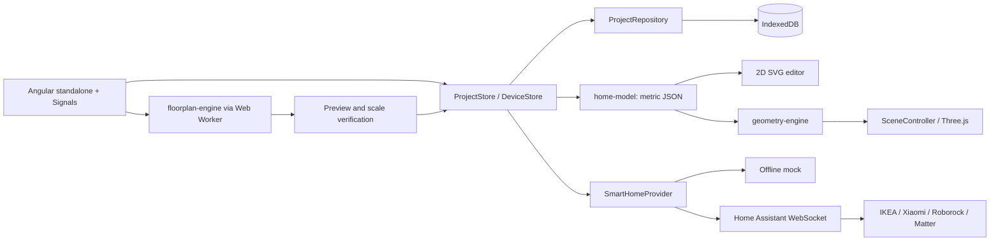

# Architecture

The npm workspace and TypeScript aliases avoid an extra monorepo orchestrator. The four domain packages do not import Angular. The app uses lazy routing and Signals; RxJS is available as an Angular dependency but is not needed to duplicate provider streams.

`ProjectStore` applies edits to a project copy and publishes only after validation. Failed transactions leave the active project intact. Undo/redo retains up to 30 snapshots; camera moves save without consuming geometry history. `discoverRooms` traverses directed half-edges of the planar wall graph to find closed faces. Drawing splits existing segments when a new endpoint lies on a wall, without splitting an opening. Interior crossings require explicit endpoints at the intersection.

`ProjectRepository` separates persistence from UI. Three IndexedDB object stores contain projects, asset Blobs, and non-sensitive preferences. Saves are serialized and resolve only after transaction commit. The HTTP adapter implements the same contract, as described below.

`floorplan-engine` processes RGBA rasters using thresholds, orthogonal band scanning, and Hough/PCA for slanted lines. Density/gap analysis proposes openings; only accepted proposals become parametric openings. It merges parallel edges, joins nearby endpoints, and splits intersections before constructing the shared graph; project validation also checks proposals. The Web Worker receives a transferable buffer without access to providers/credentials. The dialog displays exclusions and scale, then applies one transaction to a new floor. Face discovery ignores dangling branches while retaining incomplete walls. See [FLOORPLAN_GENERATION.md](FLOORPLAN_GENERATION.md).

`SmartHomeProvider` normalizes entities, states, and capabilities. The HA provider authenticates and subscribes before loading the initial snapshot, buffering events to avoid losing concurrent updates. Each command has a monotonic ID, timeout, and response promise. Errors do not produce optimistic state changes. Connection loss rejects pending commands and retries with backoff capped around 30 seconds; invalid tokens require sign-in again. Closing clears timers, transport listeners, and tokens. Optional registries do not block entity control.

The renderer knows no APIs, tokens, or manufacturers: it receives the project and normalized states. A geometry fingerprint avoids rebuilding meshes for state, binding, or camera changes; it excludes floor-plan images used only by the 2D editor. Transaction copies duplicate mutable objects but share immutable strings, avoiding unnecessary raster copies in history. Floor geometry changes rebuild its group without recreating renderer/controls. Walls are partitioned along openings and built only in solid intervals; floors use Three.js triangulation of simple boundaries, without heavy CSG.

`SceneController` handles camera, raycast, resize, on-demand rendering, WebGL loss/restoration, and cleanup. There is no continuous animation loop. Hidden tabs cancel pending frames. Pixel ratio/point-light limits depend on profile (low: 1/0, medium: 1.5/4, high: 2/8); dynamic shadows are disabled. Orbit camera stays above the floor with distance/pan limits; it is not wall-collision physics.

PWA support includes manifest, icons, production Angular service worker, and installation prompt when the browser offers it. The frontend is static; Nginx does not render scenes. The optional backend is a separate Java/Maven repository: /api/v1, file-based H2 or configurable PostgreSQL, PBKDF2 hashes, non-serialized servlet sessions, and HA bridge. The frontend also works with IndexedDB without a server.

Map presentation visually cuts walls without changing metric heights/openings. `MapOverlay` projects HTML labels/buttons during on-demand frames: room names use points inside polygons; pins receive normalized states only. State changes update pins/materials; only geometry/presentation changes rebuild the group. Teardown removes/disposes overlays and added outlines. Virtual home is a full-screen view of the same renderer with controls for the selected device.

Vacuum grouping is a pure `device-model` function using normalized registry identities and manual bindings, without manufacturer protocols. The HA provider resolves Roborock robot/dock identity and available actions. `DeviceStore` keeps position telemetry in memory and handles opt-in monitoring with a 60-second interval/cooldown, background suspension, and provider-change reset. `home-model` stores only static alignment anchors. `robotPlacements` produces metric renderer points while checking provider, floor, selected map, and boundaries: moving a point neither rebuilds meshes nor changes saved furniture coordinates. See [ROBOT_VACUUM.md](ROBOT_VACUUM.md).

OAuth callback handling precedes routing and uses a separate window to keep nonce/verifier in memory. `HomeAssistantSession` handles deduplicated renewal, expiration, abort, and revocation; the provider receives an updated-token accessor separate from components/renderer. No new dependency. See [HOME_ASSISTANT_AUTH.md](HOME_ASSISTANT_AUTH.md).

Room cleaning is the normalized `clean-areas` command; the UI receives provider `CleaningArea[]`. The HA adapter checks feature/service availability, rereads mappings/registry before dispatch, and uses only `vacuum.clean_area`. 3D room names do not imply destinations. The same UI works with the offline mock.

StorageService selects the repository: local IndexedDB and HttpProjectRepository implement the same contract. Non-sensitive preferences stay local; HTTP uses ETag, If-Match/If-None-Match, and cookies with in-memory CSRF. The save queue captures its target repository; storage changes await completion. Reloading after conflict suspends autosave and drains the queue before acquiring a new revision. Sign-in failures do not redirect pending writes to IndexedDB.

The backend imports no TypeScript packages. It validates JSON v1 at its own domain boundary; API/OpenAPI live in the server repository. Import/restore are transactional; copies receive fresh IDs. Files are immutable DB BLOBs owned by projects and deleted in cascade. ZIPs are not extracted to the filesystem. The HA provider receives a session-authenticated WebSocket transport without browser tokens or renderer coupling to proprietary APIs. See [BACKEND.md](BACKEND.md).

The owner profile stores the last opened home and encrypted HA authorization separately from HomeProject. Server sign-in derives a RAM key from the password and dedicated encryption salt; the refresh token is AES-256-GCM ciphertext in the DB and the access token stays in RAM cache. HTTP expiration closes session bridges and destroys its key without revoking owner authorization. Explicit HA disconnection removes the connection and closes every owner bridge. After restarting, sign-in reopens the remembered home and recreates HA transport; renderer, bindings, schema v1, and geometric coordinates stay unchanged.
